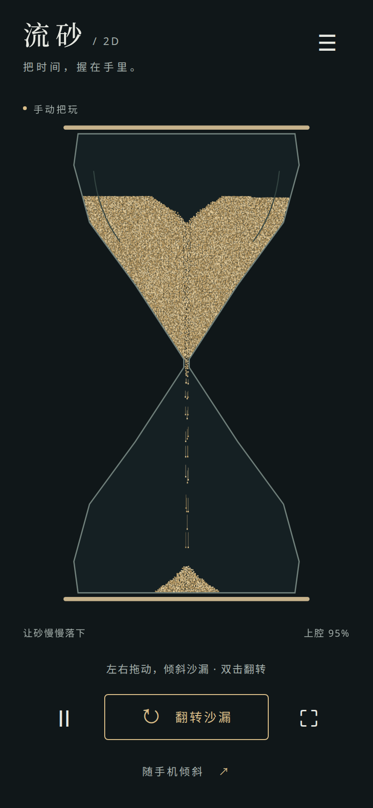

# 流砂 · Sandglass 2D

一只可以随手翻转的二维沙漏。让砂慢慢落下，堆成小山，再翻过来玩一次。

**[打开沙漏](https://nigh.github.io/sandglass-2d/)** · 免费，无需登录，手机和电脑都能玩。



## 怎么玩

- **拖动**沙漏来倾斜，**双击**画面或点「翻转沙漏」把它倒过来。
- 用手机打开后，点**「随手机倾斜」**并允许运动权限。竖着握住手机，慢慢转动，或轻轻摇晃，看砂带着惯性散开、再重新堆起来。平放手机时，屏幕平面上的重力接近零。
- 点 **Ⅱ** 暂停，再点一次继续。右下角的 **⛶** 进入沉浸模式，点「退出沉浸」返回。浏览器允许时会全屏并保持屏幕常亮。
- 右上角 **☰** 可以换砂的颜色、调整传感器方向或重新装砂。
- 电脑上也能用 **← →** 倾斜、**F** 翻转、**空格**暂停。

没有传感器、不想授权，直接拖动就可以。传感器模式下拖动或点翻转会回到手动模式。翻转保留现有沙粒；「重新装砂」才会恢复起始分布。

## 没有反应，或者方向反了？

请在 Safari 或 Chrome 中直接打开上面的 HTTPS 链接，再尝试授权。部分内置浏览器不提供运动传感器。竖直握住手机时，如果砂往上走，在设置里切换「传感器方向反了」。

读数中断时会显示提示并将重力归零，恢复读数后继续。也可以点「回到手动把玩」。切到后台会暂停计算，回来后不快进补算。所有模拟和传感器数据都留在本机，没有账号、统计或数据上传。

## 这个版本有什么不同

它是 [三维流砂](https://github.com/Nigh/sandglass) 的独立重写。现在使用 **一万粒细砂**，窄口让砂沿一条细线慢慢流下；不再是原先的大颗圆球。流动中的短拖影来自每粒砂实际的运动速度，落定后不会继续闪动。

砂采用无弹性的颗粒网格模型：撞到砂堆后消耗动能，表面的砂超过摩擦限制会滑落，不储存弹簧能量反复上下弹。空中的砂保留速度，摇晃手机时会被甩动，停止摇晃后也不会立刻抹掉惯性。整个砂堆落定后停止更新，倾斜、翻转或摇晃会唤醒它。

物理计算放在 Web Worker 中，Canvas 2D 批量绘制细砂。页面没有运行时依赖、三维引擎或远程字体。设置里能看到实时帧率和物理步耗时。

这是供把玩的颗粒模拟，**不是精确计时器**。流完所需时间随姿态、砂堆和设备负载变化。颗粒网格与有效摩擦不能代表所有真实砂材；固定步长、角度测量方法和性能结果见 [验证记录](docs/VALIDATION.md)。

## 在本地运行

需要 Node.js 22.12+（推荐 24）：

```sh
npm ci
npm run dev
```

打开终端显示的地址即可。手机通过普通局域网 HTTP 地址打开时，通常只能拖动；运动传感器需要 HTTPS。

```sh
npm test             # 物理与坐标变换检查
npm run build        # 生成 dist
npm run benchmark    # 完整细砂流动、静止、堆角与耗时（需要稍等）
npm run test:browser # 先启动开发服务器；默认使用 /usr/bin/google-chrome
```

浏览器检查可通过 `CHROME_PATH` 指定 Chromium，通过 `BASE_URL` 检查其他地址。

## 自动发布

推送到 `main` 后，GitHub Actions 会运行测试、构建并自动部署到 GitHub Pages。工作流位于 [deploy-pages.yml](.github/workflows/deploy-pages.yml)。Fork 后，在仓库 **Settings → Pages → Build and deployment → Source** 选择 **GitHub Actions**，再推送或手动运行工作流；站点子路径会自动配置。
